<!-- GENERATED FILE: rendered from docs/report_template.md by `python run_pipeline.py`. Edit the template, not this file. -->
# SEA-Sentinel: early detection, nowcasting and forecasting of priority animal diseases in Southeast Asia

**Technical report: WOAH International Datathon 2026**

> **Status.** All sections cover completed, reproducible work. This report is generated by `python run_pipeline.py`: every number and results table below is
> computed from the data (extracted 21 Oct 2026; weekly panel through the week of
> 12 Oct 2026).

---

## Summary

SEA-Sentinel is an open-data proof of concept. It covers 11 Southeast Asian countries and two
priority diseases: highly pathogenic avian influenza (HPAI) in poultry and African swine fever (ASF)
in domestic swine. It addresses three problems in regional surveillance: delayed reporting,
incomplete surveillance, and limited early warning. Rabies in dogs was in the original scope but was
dropped: its records are sparse and dog populations are unknown.

We built a reproducible Python pipeline that standardises, deduplicates and audits outbreak
reports. Its main source is 26,482 FAO EMPRES-i Plus records, with 151
WOAH WAHIS events used as an independent reference. The pipeline turns these into a country ×
disease × week panel where a missing report is never counted as zero.

**Coverage.** Of the 22 country–disease series, 10 have enough dated
observations to support forecasting:

- *HPAI:* Cambodia, Indonesia, Philippines, Thailand and Vietnam.
- *ASF:* Laos, Malaysia, Philippines, Thailand and Vietnam.

4 series have no records.

**Reporting delays.** The median delay from observation to report is 0 days for
HPAI and 112 days for ASF, so recent counts can be heavily under-reported.

**Nowcasting.** A chain-ladder delay model combined with an empirical-Bayes Poisson–Gamma posterior
was tested on 37 as-of snapshots rebuilt from report dates. For series without batch
reporting it almost removes the naive under-count in the most recent four weeks (e.g.
HPAI bias −0.34 → −0.03 outbreaks per week) and improves CRPS by 3–12%; its
intervals are conservative. Batch-reported series such as Philippines ASF are
flagged as unreliable.

**Forecasting.** Five models were backtested on 19,648 weekly forecasts per model. The
Rolling NB model, chosen on forecasts before 2022, is 23% better than
a naive benchmark on held-out forecasts (relative CRPS 0.77) and beats it in
8 of 9 series. A real-time replay shows that incomplete recent data
make forecasting much harder, and that nowcast-corrected inputs lower the error by
16% overall, although not in every series. Recent temperature and rainfall
anomalies (NOAA CPC) make no material difference to the forecasts (§8.5).

**Early detection.** We tested two prospective detection methods: a rolling baseline and a
negative-binomial baseline. At about 1.6–2.0 alarms per series per year, they
detect 46–52% of WAHIS official event onsets within −2 to +4
weeks; alarms at random would hit 14–16%. They also detect 70–73% of
simulated outbreaks of 5 baseline standard deviations.

- *In real time,* replayed on the data as reported at the time, 64–67% of these
  alarms are raised within 4 weeks, and 17–20% not within 12 weeks.
  Real-time alarms are reliable (92–97% confirmed by the final data); nowcast
  correction makes them slightly earlier but much less reliable (52–58% confirmed).
- *At province level,* with the same number of alarms, a rolling baseline per province detects
  49% of simulated 5-outbreak clusters in one province, against
  28% nationally. It does not detect more WAHIS events.

**Priority alerts.** These signals, together with wild-bird HPAI reports, are combined into a
High / Medium / Low priority per country and disease, with the reasons listed (§9). For the week of
12 Oct 2026: 2 High, 5 Medium and 8 Low series; High: Philippines ASF and Vietnam HPAI.

## 1. Objectives and scope

| Item | Scope |
|---|---|
| Countries | Brunei, Cambodia, Indonesia, Laos, Malaysia, Myanmar, Philippines, Singapore, Thailand, Timor-Leste, Vietnam |
| Diseases | HPAI in poultry and ASF in domestic swine. Rabies in dogs was dropped from the original scope (1,958 EMPRES-i records): too sparse, and no dog population data |
| Outcome | Number of reported outbreaks per epidemiological week (Monday–Sunday) |
| Objectives | (1) early detection of unusual increases; (2) nowcasting of recent under-reporting; (3) probabilistic 1–4-week forecasts with 80% and 95% prediction intervals |

## 2. Data

| ID | Source | Retrieved | Content | Use |
|---|---|---|---|---|
| SRC003 | FAO EMPRES-i Plus | 2026-10-21 | 26,482 records, 2002–2026; place, observation date and report date for each outbreak | Primary outbreak series |
| SRC001 | WOAH WAHIS event lists | 2026-10-20 | 151 events: event start, reason, latest report | Reference events for evaluation |
| SRC004 | FAOSTAT QCL | 2026-10-20 | Annual stocks of chickens, ducks, geese, turkeys and pigs, 2000–2024 | Population offsets |
| SRC005 | FAO GLW | 2026-10-22 | National livestock census totals behind the GLW grids | Cross-check of FAOSTAT levels (§3.4) |
| SRC011 | NOAA CPC daily climate | 2026-10-24 | Daily precipitation and maximum / minimum temperature (0.5° grid), 2003–2026, averaged over each country's land cells | Climate test of the forecasts (§8.5) |
| SRC007 | World Bank WDI | 2026-10-24 | Population by sex, land area, population density, GDP, GDP per capita and trade, 2000–2025 | Context (`socioeconomic_country_year.csv`) |
| SRC012 | Natural Earth | 2026-10-24 | Country outlines (1:50m) | Averaging the climate grids per country |

The covariate sources are open and are fetched with `python -m sea_sentinel.download`; the
pipeline itself stays offline.

**Provenance.** Raw files are copied unchanged into `data/raw/`, with SHA-256 checksums and
retrieval dates in `data/raw/MANIFEST.csv`. Licences and citations are in `DATA_LICENSES.md`.

**Units of observation are not mixed.**
- *EMPRES-i is counted at outbreak level.* It already includes 7,493 records sourced
  from WOAH.
- *WAHIS is counted at event level.* One event can contain many outbreaks.
- *They are never added together.* The WAHIS events serve as an independent reference, not as
  extra counts.

**Data inventory.** The project's dataset inventory workbook is filled in automatically: source
register, the 22-cell coverage matrix and the quality checklist. The output is
`outputs/tables/SEA_Sentinel_Dataset_Inventory_assessed.xlsx`.

## 3. Data processing

### 3.1 Standardisation and scope

5 EMPRES-i rows had unquoted commas in free-text fields; these were repaired by
anchoring on the fixed columns. Countries were mapped to ISO3 codes and dates parsed.

A record is in scope if it is **confirmed** and falls in one of two groups:

- **HPAI:** domestic or unspecified poultry; low-pathogenicity (LPAI) serotypes excluded.
- **ASF:** domestic swine; wild boar excluded.

Rabies records in the download are excluded as outside scope.

Every excluded record keeps its reason:

| Reason | Records |
|---|---|
| Included | 22,386 |
| Not confirmed (suspected or denied) | 1,992 |
| Disease outside scope (rabies) | 1,958 |
| Swine that are not domestic | 69 |
| Low-pathogenicity serotype | 56 |
| Birds that are not poultry | 21 |

**Dates.** The event date is the observation date. When that is missing, the report date is used
instead and the row is flagged. Observation dates are present for 98% of HPAI
and 64% of ASF outbreaks. The largest gap is
Vietnam ASF (25% observation-dated).

### 3.2 Deduplication

The same outbreak can be reported more than once, so records are merged in two passes:

1. **Exact repeats.** Rows from the same source with the same place, coordinates, date and
   locality are merged. This also merges the per-species rows of a single outbreak.
2. **Cross-source repeats.** Rows from different reporting channels are merged when they are at
   most 1 km and at most 3 days apart. Pairs are linked closest
   first, and a group never contains two records from the same source.

**How the thresholds were chosen.** Pairs of nearby records from the same source show how
outbreaks normally cluster in space and time. Pairs from different sources show that clustering
plus any duplicates. The ratio between the two counts therefore rises only where duplicates are.

- *By time gap* (records within 1 km): the ratio is 0.17 on the same
  day, 0.07 at 1 day and 0.04 at 2–3 days, then levels off at about
  0.03.
- *By distance* (records within 3 days): the ratio is 0.47 at
  0.1–0.5 km and 0.18 at 0.5–1 km, then 0.02–0.05 beyond 1 km.

Across a grid of 0.5–5 km and 0–14 days, the total outbreak count moves by only
−0.8% to +0.2%. Result: 22,386 records → 21,861 after exact repeats →
21,737 distinct outbreaks (HPAI 13,702; ASF 8,035).

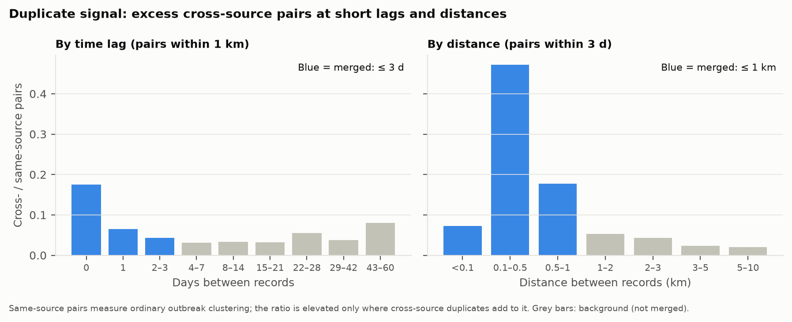

### 3.3 Weekly panel: missing is not zero

The panel has one row per country × disease × week. Weekly values are filled as follows:

- **Before the first and after the last reported outbreak:** missing, not zero.
- **Between those dates:** weeks with no report count as zero.
- **Silent stretches of 26 weeks or more inside that span:** flagged as possible
  surveillance gaps.

### 3.4 Population offsets

The at-risk population comes from FAOSTAT annual stocks:

- **HPAI:** chickens + ducks + geese + turkeys.
- **ASF:** pigs.

**No look-ahead.** FAOSTAT publishes about 1–2 years late, so each annual value is pinned to 1 July
2 years after its reference year, and weeks are interpolated between these
points on the log scale. A stock thus enters the interpolation one year after its reference year
and carries full weight after two, so each week uses essentially only stocks already published, in
the detection results and all their backtests. Weeks after July 2026 reuse the
2024 value and are flagged. Singapore has no pig population ("data cannot
exist"), so its value is missing rather than zero.

**How reliable are the levels?** The GLW metadata lists the national census behind each country's
gridded map. Of 18 census totals for chickens and pigs, 11 are within
10% of FAOSTAT for the same year. The others differ by more than
10%:

| Country | Animals | Census year | Census (million) | FAOSTAT, same year (million) | Census / FAOSTAT |
|---|---|---|---|---|---|
| Indonesia | Chickens | 2019 | 1,474.6 | 3,808.1 | 0.39 |
| Laos | Chickens | 2009 | 16.0 | 22.5 | 0.71 |
| Thailand | Chickens | 2004 | 191.4 | 251.0 | 0.76 |
| Vietnam | Pigs | 2009 | 21.8 | 27.6 | 0.79 |
| Indonesia | Pigs | 2017 | 6.8 | 8.3 | 0.83 |
| Vietnam | Chickens | 2011 | 282.0 | 225.8 | 1.25 |
| Cambodia | Chickens | 2017 | 21.5 | 13.2 (imputed) | 1.63 |

This matters less than it seems. The negative-binomial baseline refits its level in every window,
so a FAOSTAT series that is wrong by a constant factor gives the same alarms; only errors in its
change over time can move them. §6.3 tests this by removing the offset altogether.

## 4. Coverage audit

All 22 country–disease combinations were audited.

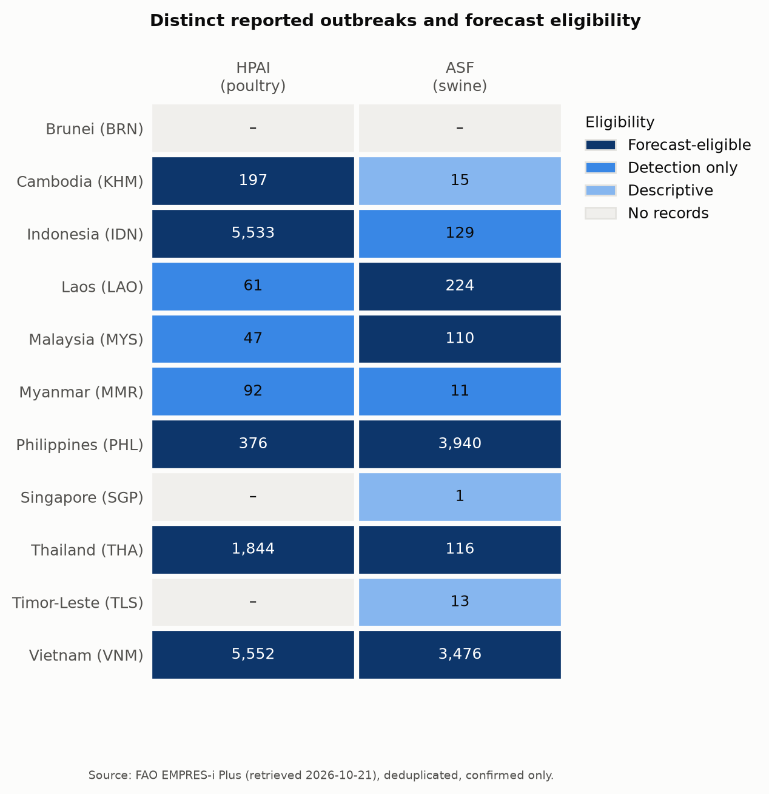

A series is **eligible for forecasting** if it has at least 100
observation-dated outbreaks, at least 104 weeks between its first and last report,
and at least 30 weeks with outbreaks.

| Tier | Series | n |
|---|---|---|
| Forecast + detection | HPAI: KHM, IDN, PHL, THA*, VNM; ASF: LAO, MYS, PHL, THA, VNM | 10 |
| Detection / descriptive only | HPAI: LAO, MYS, MMR; ASF: IDN, MMR | 5 |
| Descriptive only (sparse) | ASF: KHM, SGP, TLS | 3 |
| No records | HPAI: BRN, SGP, TLS; ASF: BRN | 4 |

\*Thailand HPAI data stop in November 2008, so forecasts for it can only be retrospective.

Per-cell details are in `outputs/tables/coverage_matrix.csv`: dates, record counts, completeness of
observation and report dates, weeks with outbreaks, gap weeks, WAHIS event counts and exclusions.

## 5. Reporting delays

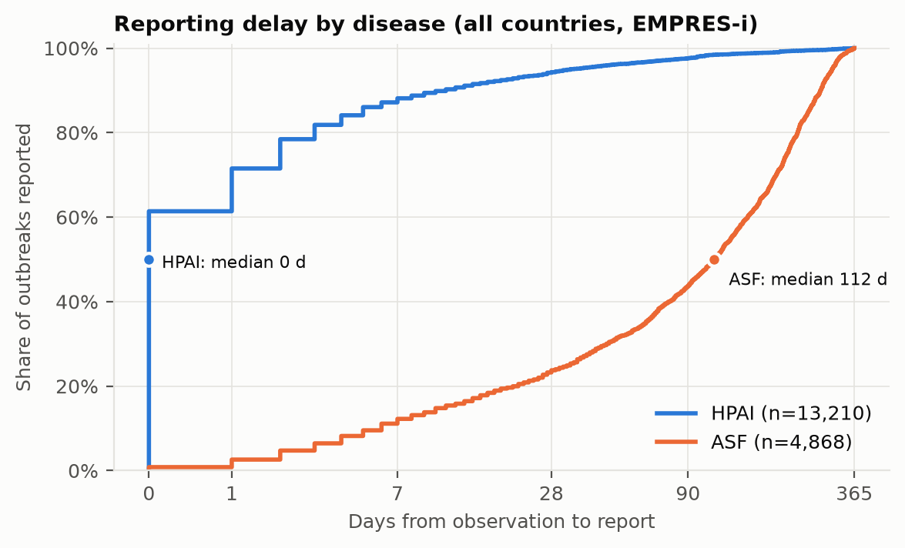

| Disease | Outbreaks with both dates | Median delay (days) | 90th percentile (days) |
|---|---|---|---|
| HPAI | 13,210 | 0 | 11 |
| ASF | 4,868 | 112 | 275 |

Delays vary a lot by country. The longest median delays are in Indonesia ASF (median 192 days), Malaysia HPAI (median 186 days) and Philippines ASF (median 164 days). Mostly
same-day reporting is seen in Thailand HPAI (89% same-day) and Vietnam HPAI (87% same-day), which may mean the observation date was simply
set to the report date; this is reported (`pct_zero_delay`) because it affects nowcasting. Delays
that are negative or longer than a year are left out of these statistics.

## 6. Early detection

### 6.1 Methods

Detection is **prospective**: week *t* is compared only with data from before week
*t − 2*. The 2-week guard band keeps an emerging outbreak out of its own
baseline. Weeks with missing data are dropped from the baseline, not counted as zero. A week can
alarm only if it has at least one reported outbreak.

- **Rolling baseline (EARS-C2 style).** Mean and SD of the previous 52 weeks, using
  only observed weeks and requiring at least 26. A week alarms if its count is
  above mean + z·SD.
- **Negative-binomial baseline.** A model fitted on the previous 104 weeks, with annual
  seasonality and the log of the at-risk population as an offset. Over-dispersion (NB2) is
  estimated by the method of moments. A week alarms if its count is above the q-quantile of
  NB(μ, α).
  - *Robustness to past outbreaks:* following Farrington and Noufaily et al. (2013), the model is
    refitted with past outbreak weeks down-weighted. A week is down-weighted when its quasi-Poisson
    residual is above 2.58.
  - *Dispersion:* α is then estimated only from weeks that were not down-weighted. Without this,
    earlier epidemics inflate α and hide later ones (a problem our unit tests revealed).

### 6.2 Evaluation design

There is no record of which weeks truly had no outbreaks, so the methods are evaluated three ways.
Each series counts equally (15 series).

1. **Alarm rate on real data.** The share of weeks with an alarm. Some alarms are real surges, so
   this is an upper bound on the false-alert rate.
2. **Simulated outbreaks** (labelled as a simulation). At every evaluable week, a synthetic
   outbreak is added to the real series. Its total size is drawn from Poisson(k × baseline SD),
   with k = 2, 3, 5 or 10, and spread over 3 weeks (30/45/25%). It counts as detected
   if any of those weeks alarms. Because of the guard band, the injected weeks never enter their
   own baselines, so each injection is evaluated exactly without refitting.
3. **WAHIS reference events.** There are 124 official event starts (new or recurrent
   introductions) within the evaluated periods. An event counts as detected if an alarm falls
   between 2 weeks before and 4 weeks after its start. The **chance rate**
   applies the same window to every evaluable week, giving the hit rate expected without any real
   signal. WAHIS events and the WOAH-sourced EMPRES-i records come from the same national reports,
   so hit rates are also shown separately for events with no WOAH-sourced record in their window.

### 6.3 Results

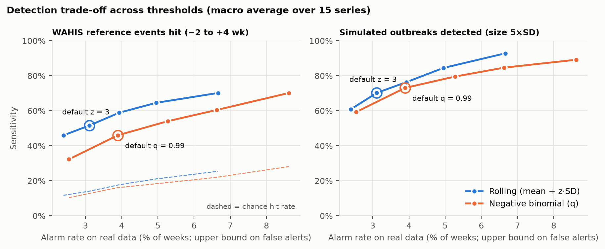

| Default threshold | Alarm rate | Alarms per series-year | WAHIS events hit (chance) | Simulated sensitivity, k = 2 / 5 / 10 |
|---|---|---|---|---|
| Rolling z = 3 | 3.1% | 1.6 | 52% (14%) | 54% / 70% / 96% |
| Negative binomial q = 0.99 | 3.9% | 2.0 | 46% (16%) | 52% / 73% / 89% |

**Findings:**

- **Both methods work.** They detect official event onsets 2.9–3.7 times more often
  than chance.
- **Not an echo of WAHIS.** Of the reference events, 24 have EMPRES-i records in
  their window but none from WOAH. Detection still finds 38–42% of them (chance
  15–18%), against 49–55% (chance 14–16%) of the
  98 events with WOAH-sourced records.
- **Population offsets barely matter.** Removing the offset from the negative-binomial baseline
  changes 13 alarm weeks across the 15 series that have one
  (339 alarms with the offset). WAHIS events hit: 46% with,
  46% without; simulated 5 SD outbreaks: 73% and
  73%. Errors in FAOSTAT stocks therefore have little effect on detection.
- **Comparison at the default thresholds.** The rolling baseline hits more WAHIS
  events (52% vs 46%). On simulated outbreaks of 5 SD, the rolling baseline
  detects 70% and the negative-binomial baseline 73%; the full
  trade-off curves are in the figure above.
- **Recovery after large epidemics.** After Vietnam ASF's peak in July 2025, the negative-binomial threshold took 13 weeks to return to within 25% of its pre-peak level, while the rolling threshold took 58 weeks. Past epidemics inside the rolling 52-week window inflate its SD.
- **Detection works best on sporadic series:** Myanmar HPAI 7 of 8, Laos HPAI 11 of 13 and Cambodia HPAI 16 of 25 (WAHIS events detected,
  rolling baseline).
- **It works worst on endemic national aggregates:** Vietnam HPAI 9 of 40. A new provincial
  event barely changes a national weekly count; §6.5 tests detection at province level.
- **Current signal (last 12 weeks):** both methods alarm for Laos ASF (first alarm in the week of 27 Jul 2026), Thailand ASF (first alarm in the week of 24 Aug 2026) and Vietnam HPAI (first alarm in the week of 27 Jul 2026). The latest weeks are still incomplete;
  §6.4 shows how this delays alarms.

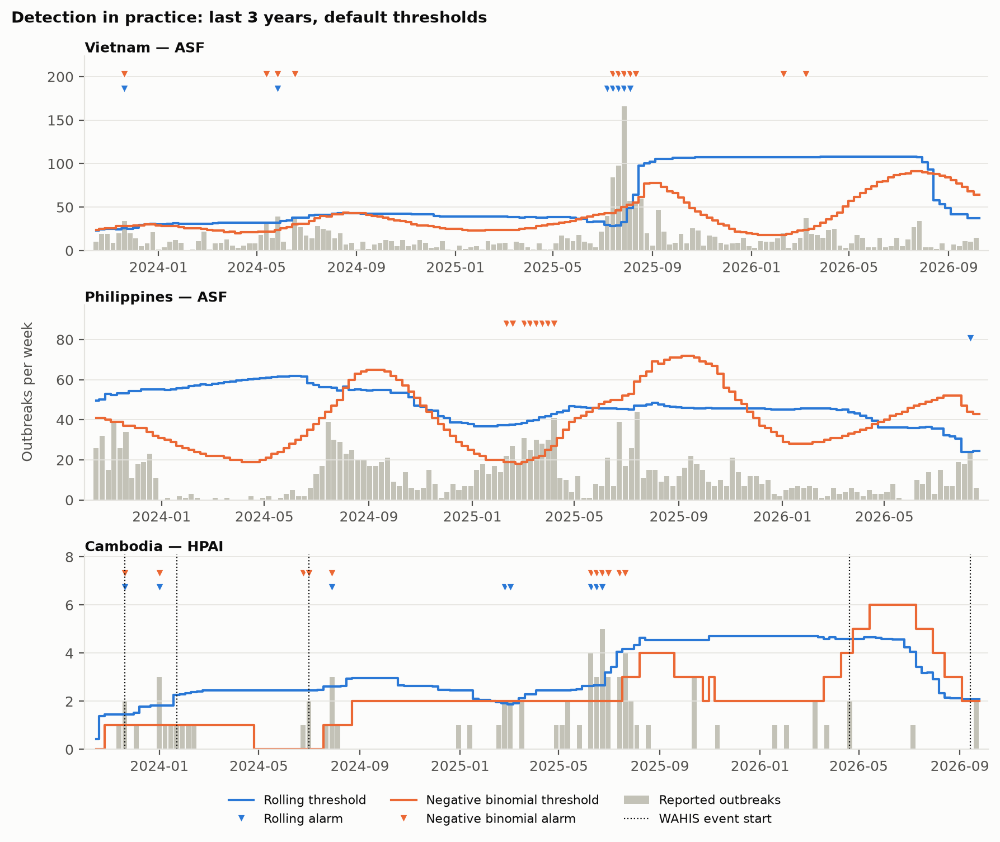

### 6.4 Real-time replay

The results above use finalized data. In real time, recent weeks are under-reported, and so is the
baseline they are compared with. The replay repeats detection as it could have run at the time:

- **Snapshots.** At each of 198 weekly as-of dates from January 2022, every series is
  rebuilt from the records reported by then (from report dates), and both methods judge the last
  12 weeks again. The most recent snapshot is one year before the end of the panel, so
  the final counts are nearly complete.
- **Two inputs.** The counts as reported at the time, or the last 52 weeks corrected by the nowcast
  of §7. A week can still alarm only if at least one outbreak has been reported.
- **Reference.** The 164 alarms raised on finalized data (both methods, default
  thresholds). For each, the replay records when it was first flagged in real time; for each
  real-time alarm, whether the finalized data flag the same week.

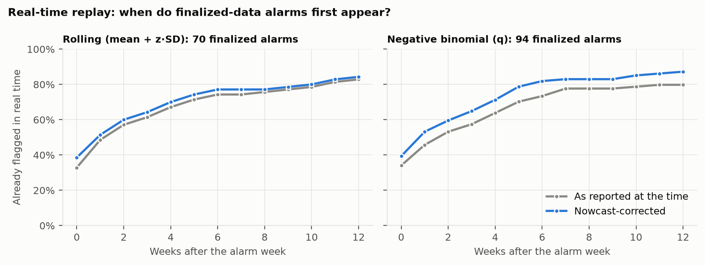

| Method | Input | Finalized alarms | Flagged within 0 / 1 / 4 / 12 weeks | Real-time alarms | Confirmed |
|---|---|---|---|---|---|
| Rolling | As reported | 70 | 33% / 49% / 67% / 83% | 63 | 92% |
| Rolling | Nowcast-corrected | 70 | 39% / 51% / 70% / 84% | 102 | 58% |
| Negative-binomial | As reported | 94 | 34% / 46% / 64% / 80% | 77 | 97% |
| Negative-binomial | Nowcast-corrected | 94 | 39% / 53% / 71% / 87% | 158 | 52% |

**Findings:**

- **Real-time alarms come late.** Only 33–34% of finalized-data alarms are flagged
  at the end of their own week, and 64–67% within 4 weeks; 17–20%
  are still not flagged after 12 weeks. Delays depend on the disease: within 4 weeks,
  70–78% of HPAI alarms but 57–58% of ASF alarms are flagged.
- **What is flagged is real.** 92–97% of the alarms raised on the counts as
  reported are confirmed by the finalized data.
- **The nowcast trades reliability for speed.** Nowcast-corrected inputs flag 70–71%
  within 4 weeks, but only 52–58% of their alarms are confirmed: the correction
  also lifts weeks that turn out not to be unusual. This suggests raising alarms on the raw counts
  and using the nowcast to judge how large a flagged event may become.

### 6.5 Subnational detection

National counts hide provincial events in endemic series. Detection is therefore also run per
first-level administrative unit (admin1: province or region), which almost every EMPRES-i record
carries.

- **Series.** HPAI and ASF series with at least 5 units of at least
  20 outbreaks each: Indonesia HPAI, Philippines ASF, Thailand HPAI, Vietnam HPAI and Vietnam ASF. In total 161 units are monitored,
  covering 88–99% of each series' outbreaks.
- **No look-ahead in the choice of units.** A unit is monitored only once it has
  20 outbreaks before its baseline window closes. Unit weeks follow the national
  reporting window; inside it, a unit with no report counts as zero. Units have no population
  offset, because FAOSTAT has no stocks below national level.
- **Scores.** Each unit-week gets an exceedance score from the same two baselines: the z-score for
  the rolling method, −log₁₀ *P*(*Y* ≥ count) for the negative binomial. Empty baselines are scored
  as if they held one outbreak. The subnational system alarms when the highest unit score passes a
  cut-off.
- **Same alarm budget.** With per-unit default thresholds, at least one unit alarms in
  28–30% of weeks, far too often to be useful. The comparison therefore fixes
  the alarm rate: one cut-off per method, common to all series, makes the subnational system alarm
  as often as national detection at its default threshold.
- **Evaluation.** WAHIS events as in §6.2 (50 events), and simulated localized
  clusters: 3, 5 and 10 outbreaks added to one unit over 3 weeks, at every week where that
  unit and the nation are evaluable. The national count gets the same outbreaks.

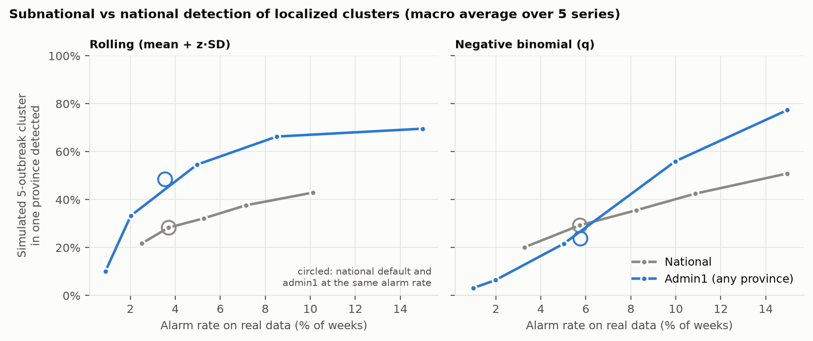

| Method | System | Alarm rate | WAHIS events hit (chance) | Simulated cluster of 3 / 5 / 10 outbreaks |
|---|---|---|---|---|
| Rolling | National, default threshold | 3.7% | 22% (14%) | 22% / 28% / 36% |
| Rolling | Admin1, same alarm rate | 3.5% | 16% (17%) | 36% / 49% / 58% |
| Negative-binomial | National, default threshold | 5.7% | 24% (19%) | 23% / 29% / 39% |
| Negative-binomial | Admin1, same alarm rate | 5.7% | 14% (10%) | 15% / 24% / 70% |

**Findings:**

- **Rolling baselines per province detect localized clusters better.** At the same alarm rate, they
  detect 49% of 5-outbreak clusters in one province, against 28%
  nationally.
- **Negative-binomial scores only help for large clusters**: 24% against
  29% for 5 outbreaks, but 70% against 39% for
  clusters of 10. The rolling method is therefore the one to use per province.
- **No gain on WAHIS events** (14–16% detected, against 22–24% nationally).
  In most official events no province reports more than one outbreak in a week around the start,
  which stays below the common cut-off. We did not tune the cut-off to these events, which serve as
  the evaluation reference.

## 7. Nowcasting

### 7.1 Methods

For an as-of week *T*, event week *w = T − d* is incomplete: only outbreaks with a reporting delay
of at most *d* weeks are known. The nowcast target is the count eventually reported within
52 weeks. Later reports (535 outbreaks) are treated as batch back-fills.

1. **Delay model (chain ladder).** A cumulative reporting triangle is built from records reported by
   *T*. For each delay *d*, a development factor is computed from the 104 most recent
   event weeks where it can be observed: *f_d* = Σ *C(w, d+1)* / Σ *C(w, d)*. Completeness is then
   *F(d)* = ∏_{j≥d} 1/*f_j*, with *F*(52) = 1.
   - This uses only information available at *T* and corrects for right truncation.
   - Series with fewer than 30 records in the window use the triangle pooled across
     countries for the same disease.
2. **Posterior (Poisson–Gamma thinning).** The reported count is *C* ~ Poisson(λ·*F(d)*).
   - *Prior on the weekly rate λ:* an empirical-Bayes Gamma(*a*, *b*) taken from the
     13 most recent weeks that are at least 0.5 complete, leaving out the
     target week. Its mean is *m* = Σ*C*/Σ*F* and its variance *v* is the variance of *C/F* (at
     least *m*), so *a* = *m*²/*v* and *b* = *m*/*v*.
   - *Unreported remainder:* *R* | *C* ~ NegBin(*a* + *C*, (*b* + *F*)/(*b* + 1)). This gives exact
     quantiles even when *C* = 0.
   - *Why empirical Bayes:* during development, a prior of fixed strength proved over-confident
     once an epidemic had ended, centring recent weeks on the earlier epidemic level.
3. **Batch-reporting diagnostic.** The model assumes each outbreak's delay is independent. Where
   records arrive in bulk uploads, that assumption fails: a recent week is either fully reported or
   not at all.
   - *Concentration measure:* the share of records that arrived in the busiest 10% of report weeks.
   - *Flag:* above 0.5, using data available at *T* only; flagged nowcasts are labelled
     low confidence.
   - *Most concentrated series:* Philippines ASF, where 98% of recent records
     arrived in 10 report weeks, including 669 records in a single week.

### 7.2 Evaluation

There were 37 as-of snapshots, every 4 weeks from January 2023 to
October 2025. Each was rebuilt from report dates and scored against the count eventually
reported within 52 weeks (22,256 series-week nowcasts). The comparison method
("naive") is the count reported so far.

The metrics are bias, MAE, the coverage of the 80% and 95% intervals, and CRPS. CRPS is a proper
score that equals the absolute error for a single-number estimate, so it compares the probabilistic
nowcast with the naive count like for like. Inactive series (no reports in the past 3 years) are
skipped.

### 7.3 Results

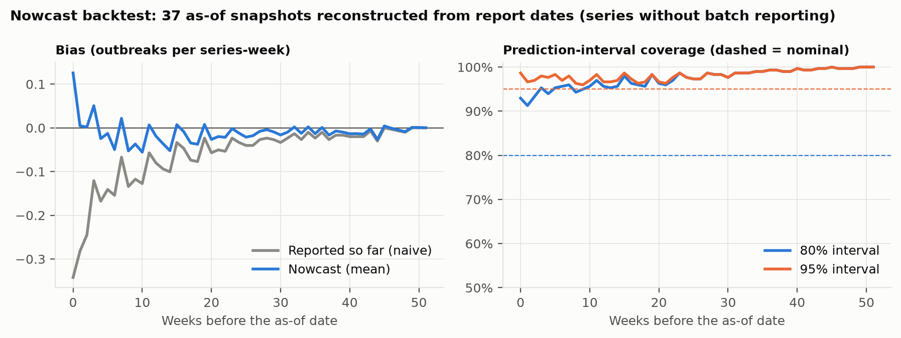

| Last 4 weeks, series without batch reporting | Naive bias | Nowcast bias | CRPS improvement vs naive | 80% / 95% coverage |
|---|---|---|---|---|
| ASF | −0.20 | +0.09 | +12% | 96% / 99% |
| HPAI | −0.34 | −0.03 | +3% | 88% / 96% |

Bias is in outbreaks per series per week.

**Findings:**

- **Bias.** The naive under-count in the most recent weeks is almost eliminated. The series with the
  largest naive under-count, 0–12 weeks back:

| Series | Naive bias | Nowcast bias | CRPS improvement |
|---|---|---|---|
| Philippines HPAI | −0.75 | −0.47 | +9% |
| Vietnam ASF | −0.34 | +0.06 | +20% |
| Indonesia HPAI | −0.30 | −0.21 | +2% |
| Vietnam HPAI | −0.16 | −0.08 | +14% |

- **Intervals are conservative.** The 80% intervals contain 88–100% of
  outcomes across diseases and horizons. The variance of the empirical-Bayes prior includes
  sampling noise; we chose not to tune it down in-sample.
- **Older weeks.** Beyond about 12 weeks, data are nearly complete and the nowcast changes the
  absolute CRPS by only 0.001–0.004.
- **Batch-reported series remain unreliable**, which is why they are flagged. Worst coverage:
  Philippines ASF (80% coverage 30%). Where the flag applies, the nowcast over-corrects in Indonesia HPAI and Vietnam HPAI.
- **Without batch reporting**, the nowcast is never materially worse than the naive count (CRPS difference at most 0.05).

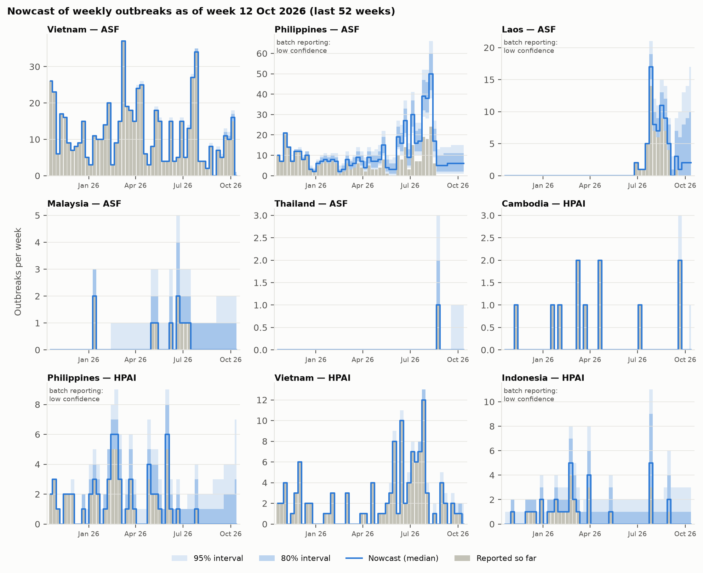

**Current picture (as of the week of 12 Oct 2026).** In Laos ASF, 0 outbreaks have been reported for the last 4 weeks, but the nowcast expects about 12 once reporting catches up (80% interval up to 10 in a single week). In Thailand ASF, 0 outbreaks have been reported for the last 4 weeks, and few more are expected (nowcast about 0). In Vietnam HPAI, 4 outbreaks have been reported for the last 4 weeks, and few more are expected (nowcast about 5).

## 8. Forecasting

### 8.1 Methods

Forecasts of weekly reported outbreaks are made 1–4 weeks ahead for the 10
forecast-eligible series. Every model returns a full predictive distribution, so all are scored the
same way. A forecast made at week *T* uses only weeks up to *T*; missing weeks are ignored, never
treated as zero.

| Model | Predictive distribution |
|---|---|
| Naive (benchmark) | Median = last observed count; uncertainty from the empirical distribution of past h-week changes over the previous 104 weeks, symmetrised (the FluSight baseline) |
| Rolling NB | Negative binomial around the mean of the last 8 weeks; dispersion from the last 26 weeks |
| Seasonal NB | Negative binomial around the same calendar weeks (±2) of up to 5 previous years |
| NB-AR | Direct h-step count regression on the log of last week's count, the 4-week mean and the 52-week mean, plus annual harmonics. Ridge-penalised Poisson GLM (penalty 0.05), refitted every 4 weeks on the last 156 weeks, with NB2 dispersion; the mean is capped at 2 × the largest count seen so far (+5) |
| Ensemble | Equal-weight mixture of the four, fixed in advance |

The cap and the ridge penalty were added after the first backtest: on a near-empty training window
(Philippines HPAI, early 2022) the unpenalised regression produced forecasts in the millions.

**Model selection without peeking.** The primary model is the one with the lowest relative CRPS on
forecasts made before 2022. Its skill is then reported on the later, held-out period.

### 8.2 Evaluation

1. **Backtest on finalized data.** A forecast is made at every week with at least
   104 observed weeks behind it (19,648 forecasts per model). This shows
   model skill if reporting were complete; it is not a real-time replay.
2. **Real-time replay.** At the 37 as-of dates of the nowcast backtest, the last
   52 weeks are replaced by what had been reported by then, either at face value or corrected by the
   nowcast. The primary model is then scored against the finalized count.

Scores: CRPS, log score (floored at −10), absolute error of the median, and 80%/95% interval
coverage. **Relative CRPS** is the geometric mean over series of each model's CRPS divided by the
naive benchmark's, so that large series do not dominate; below 1 is better than the benchmark.

### 8.3 Results

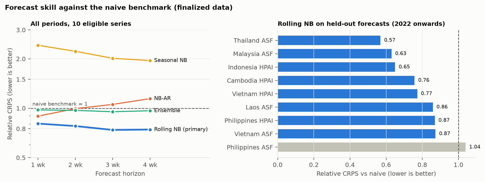

Relative CRPS by horizon (all periods), with average interval coverage:

| Model | h = 1 | h = 2 | h = 3 | h = 4 | 80% / 95% coverage |
|---|---|---|---|---|---|
| Naive (benchmark) | 1.00 | 1.00 | 1.00 | 1.00 | 87% / 96% |
| Rolling NB (primary) | 0.81 | 0.78 | 0.74 | 0.74 | 90% / 94% |
| Seasonal NB | 2.42 | 2.22 | 2.01 | 1.95 | 85% / 93% |
| NB-AR | 0.90 | 0.99 | 1.06 | 1.14 | 89% / 96% |
| Ensemble | 0.98 | 0.97 | 0.95 | 0.97 | 94% / 98% |

Model selection (relative CRPS) and held-out calibration:

| Model | Selection period | Held-out period | Held-out 80% / 95% coverage |
|---|---|---|---|
| Naive (benchmark) | 1.00 | 1.00 | 84% / 94% |
| Rolling NB (primary) | 0.66 | 0.77 | 89% / 94% |
| Seasonal NB | 2.71 | 1.36 | 85% / 91% |
| NB-AR | 1.19 | 0.84 | 88% / 95% |
| Ensemble | 1.08 | 0.83 | 93% / 97% |

**Findings:**

- **The Rolling NB model is selected and holds up on held-out data.** Its relative CRPS on
  forecasts from 2022 onwards is 0.77, i.e. 23% better than
  the naive benchmark. It beats the benchmark in 8 of 9 held-out
  series; the exception is Philippines ASF (1.04).
- **Its intervals are reasonably calibrated:** on held-out forecasts the 80% intervals contain
  89% of outcomes and the 95% intervals 94%.
- **More complex is not better here.** Seasonal NB is the weakest model (relative CRPS
  2.0–2.4), because these outbreak series are not reliably seasonal. The pre-specified
  ensemble (held-out relative CRPS 0.83) is pulled down by that member.

**Real-time replay:**

| Input to the primary model | Mean CRPS | vs finalized | 80% coverage |
|---|---|---|---|
| Finalized data (not available in real time) | 1.69 | 1.00 | 89% |
| As reported at the time | 2.59 | 1.53 | 80% |
| Nowcast-corrected | 2.18 | 1.29 | 84% |

- **Real-time forecasting is much harder.** Using the data as reported at the time raises the mean
  CRPS 1.53× compared with finalized data, so finalized-data backtests overstate
  real-time skill.
- **Nowcast correction helps overall but not everywhere.** It lowers the mean CRPS by
  16% compared with the raw reported counts. Per series (counting only changes of
  at least 0.02 in absolute CRPS and 2% in relative terms) it helps in Philippines ASF (−27%) and Philippines HPAI (−7%), and hurts in
  Vietnam HPAI (+35%) and Cambodia HPAI (+10%), where the delay model over-corrects counts that are already nearly
  complete. A variant correcting only weeks below 90% completeness
  was tried once and made no material difference, so it was not adopted. Both inputs are therefore
  published for the latest forecast.

### 8.4 Latest forecast

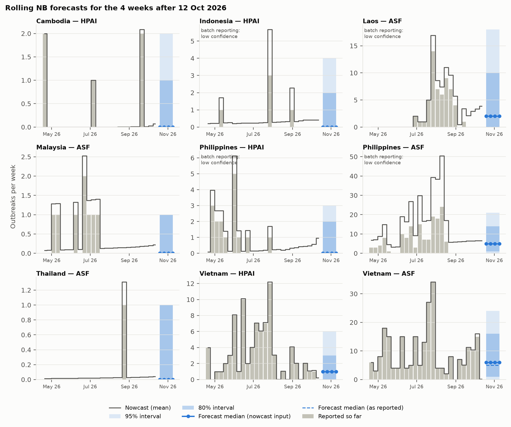

Rolling NB forecasts made at the week of 12 Oct 2026, from nowcast-corrected inputs (counts
per week):

| Series | Next week: median (80% interval) | In 4 weeks: median (80% interval) | Batch reporting |
|---|---|---|---|
| Cambodia HPAI | 0 (0–1) | 0 (0–1) |  |
| Indonesia HPAI | 0 (0–2) | 0 (0–2) | yes |
| Laos ASF | 2 (0–10) | 2 (0–10) | yes |
| Malaysia ASF | 0 (0–1) | 0 (0–1) |  |
| Philippines HPAI | 0 (0–2) | 0 (0–2) | yes |
| Philippines ASF | 5 (1–14) | 5 (1–14) | yes |
| Thailand ASF | 0 (0–1) | 0 (0–1) |  |
| Vietnam HPAI | 1 (0–3) | 1 (0–3) |  |
| Vietnam ASF | 6 (1–16) | 6 (1–16) |  |

No current forecast is made for Thailand HPAI, which has no reports in the last
3 years.
Forecasts from the as-reported inputs are in `data/processed/forecast_latest.csv`.

### 8.5 Does climate improve the forecasts?

Temperature, rainfall, water and vegetation indices and poultry density drive where and when HPAI
occurs in Europe (Opata et al. 2025). We tested whether recent weather also helps forecast weekly
outbreak counts here.

- **Predictors.** For each country and week: the mean temperature, (tmax + tmin) / 2, and the weekly
  rainfall from NOAA CPC, as anomalies from the normal for that week of the year (reference years
  2003–2021, all before the held-out period). The predictors are the mean anomalies of
  the last 4 weeks, which are known when the forecast is made.
- **Model.** NB-AR with these two predictors added ("NB-AR + climate"). It is scored at the same
  origins as NB-AR in the finalized backtest, so the comparison is paired. It is not part of the
  ensemble or the model selection.

| Forecasts | Series | Forecasts per model | NB-AR (rel. CRPS) | NB-AR + climate (rel. CRPS) | Climate / no climate | Climate better in |
|---|---|---|---|---|---|---|
| Selection (before 2022) | 8 | 11,558 | 1.19 | 1.20 | 1.013 | 2 of 8 |
| Held out (2022 on) | 9 | 8,090 | 0.84 | 0.86 | 1.014 | 2 of 9 |

**Climate makes no material difference on held-out forecasts:** the CRPS ratio is 1.014 (within 2% of 1). It is better in 2 of 9 series; the largest change either way is Malaysia ASF (−10%) and Philippines ASF (+9%). Recent weather adds little to a model that already knows the recent counts and the season.

Province-level climate, and the water and vegetation indices used by Opata et al., were not tested
(§10.3).

## 9. Priority alerts

The current signals from §6–8 are combined into one priority per country and disease, for the week
of 12 Oct 2026. Each signal that fires adds one point: **High** = 2 points or more, **Medium** = 1,
**Low** = 0. Every alert lists its reasons, so a reader can check them.

| Signal | Fires when |
|---|---|
| National alarm | Either detection method alarmed in the last 12 weeks (§6.3) |
| Province alarm | The province-level system alarmed in the same window (§6.5; 5 series) |
| Reporting backlog | The nowcast expects at least 3 outbreaks in the last 4 weeks that are not yet reported (§7) |
| Rising forecast | The Rolling NB 4-week forecast is at least 1.5× the series' usual 4-week count, and at least 2 outbreaks (§8) |
| HPAI in wild birds | Wild-bird HPAI confirmed in the country in the last 26 weeks (HPAI only) |

- **Why 12 weeks.** Recent weeks are incomplete: in the real-time replay (§6.4)
  only 64–67% of alarms appeared within 4 weeks.
- **Confidence.** Where the nowcast flags batch reporting, the backlog and forecast signals rest on
  an unreliable correction. They are then shown as notes, add no point, and confidence is *low*.
  Series with no recent reports are also *low*.
- **Wild birds.** EMPRES-i has 21 confirmed HPAI records in animals other than poultry,
  which the outbreak counts exclude. Without the 5 records of mammals or captive
  animals, they form 11 wild-bird events (Cambodia 5, Philippines 3, Indonesia 2 and Vietnam 1). That is too few to model,
  so they serve only as a signal.

**Current alerts (week of 12 Oct 2026):**

| Series | Priority | Confidence | Why | Notes |
|---|---|---|---|---|
| Philippines ASF | High | low | national alarm (rolling; latest week of 10 Aug 2026); province alarm (Region V (Bicol region), week of 10 Aug 2026) | about 26 outbreaks in the last 4 weeks not yet reported (0 so far): not counted (batch reporting) |
| Vietnam HPAI | High | normal | national alarm (rolling + NB; latest week of 27 Jul 2026); province alarm (Nam Dinh, week of 27 Jul 2026) | — |
| Indonesia HPAI | Medium | low | national alarm (NB; latest week of 27 Jul 2026) | — |
| Laos ASF | Medium | low | national alarm (rolling + NB; latest week of 31 Aug 2026) | about 12 outbreaks in the last 4 weeks not yet reported (0 so far): not counted (batch reporting). 4-week forecast 15.7 vs usual 0.7: not counted (batch reporting) |
| Philippines HPAI | Medium | low | HPAI in wild birds (2 events, latest 09 Jun 2026) | — |
| Thailand ASF | Medium | normal | national alarm (rolling + NB; latest week of 24 Aug 2026) | — |
| Vietnam ASF | Medium | normal | province alarm (Bac Kan, week of 27 Jul 2026) | — |

The other 8 monitored series are Low: Indonesia ASF, Cambodia HPAI, Laos HPAI, Myanmar ASF, Myanmar HPAI, Malaysia ASF, Malaysia HPAI and Thailand HPAI.

**Partial check against WAHIS.** The rules were fixed before this check and not tuned to it.
4 WAHIS events started in the last 26 weeks:

| Event start | Series | Reason | Priority now |
|---|---|---|---|
| 20 Sep 2026 | Cambodia HPAI | Recurrence of an eradicated disease | Low |
| 30 Jun 2026 | Laos ASF | Recurrence of an eradicated disease | Medium |
| 01 May 2026 | Philippines HPAI | First occurrence in a zone or a compartment | Medium |
| 21 Apr 2026 | Cambodia HPAI | Recurrence of an eradicated disease | Low |

The alerts would have missed the events in Cambodia HPAI: its recent counts stay within the usual range, so no signal fires.

This is a transparent decision aid built from signals evaluated in §6–8, not a validated risk
score: all signals count equally, and the combination itself has not been backtested. The full
table, including the counts behind each signal and the at-risk population, is in
`outputs/tables/priority_alerts.csv`.

## 10. Extensions

These are designs, not results: none of them could be tested with the data available.

### 10.1 Informal reporting channels (e.g. WhatsApp)

Farmers, village animal-health workers and traders often see disease before it is officially
reported. A messaging channel such as WhatsApp could bring their reports into the same pipeline:

1. **Structured message.** A short form or chatbot asks for: reporter role, village or GPS position,
   date first seen, species, numbers sick and dead, suspected disease and an optional photo.
2. **Unverified record.** Each message becomes a record with its own reporting source and the status
   *unverified*. It never enters the outbreak counts at this stage.
3. **Verification.** Veterinary services confirm or reject the report (field visit, sample, phone
   call). Only confirmed reports count, in line with the scope filter (§3.1).
4. **Merging.** Confirmed reports go through the existing deduplication (§3.2): within
   1 km and 3 days of a record from another channel they merge,
   and the more authoritative source is kept. Informal reports would rank last, after media.
5. **Alerting.** Unverified reports could feed the priority alerts (§9) as an additional,
   low-weight signal (for example, several reports from one district in a week), so that
   verification is prioritised where it matters.

News reports already enter this way: EMPRES-i holds 23 in-scope records sourced
from the media, which deduplication ranks below official sources. A real service would need the
WhatsApp Business API, consent and data-protection rules, a fixed message format, and staff to
verify reports. None of this can be evaluated here, because no such reports exist for the region.

### 10.2 Keeping the data current

The pipeline already rebuilds everything from a folder of new downloads
(`SEA_SENTINEL_SOURCE_DIR=<folder> python run_pipeline.py --force-ingest`). Whether this can run
unattended depends on each source (checked 24 Oct 2026):

| Source | Programmatic access | Automation |
|---|---|---|
| FAOSTAT | Documented bulk downloads and API | Fully automatic |
| WOAH WAHIS | No documented public API. The public interface loads its event list from an internal JSON service, which can be queried but may change without notice. | Automatic with a fallback to manual export; check WOAH's terms first |
| FAO EMPRES-i Plus | No public API; the public site exports data only through its web interface | Manual export (a few minutes per week) |

The recommended set-up is a weekly routine. Export EMPRES-i by hand into a dated folder; a
scheduled job then downloads FAOSTAT and WAHIS, runs the pipeline and the tests, and publishes the
report and the priority alerts.

**Keep every weekly snapshot.** Each run currently replaces the previous data. Keeping the dated
extracts would make the real-time replays (§6.4, §7.2, §8.2) exact, because later edits and
deletions of records would then be visible. This removes the main remaining limitation of the
real-time evaluation (§11).

### 10.3 Data that would improve accuracy

Roughly in order of expected value:

1. **Archived weekly snapshots** (§10.2): exact real-time evaluation, including record edits.
2. **Surveillance effort:** samples tested, and active versus passive surveillance. This would
   separate more disease from more testing (§11).
3. **Confirmed zero reports**, for example from WAHIS six-monthly reports: true absence instead of
   no report.
4. **Province-level livestock numbers** (the GLW rasters with admin1 boundaries): population offsets
   for the province-level detection (§6.5).
5. **Vaccination:** HPAI vaccination (Vietnam, Indonesia) and ASF vaccine use (Vietnam).
6. **Animal movement, trade and markets**, and pig prices for ASF.
7. **Wild-bird surveillance and migration** for HPAI: so far 11 wild-bird events exist
   (§9), too few to model.
8. **Outbreak size** (animals affected or culled), not just the number of outbreaks.
9. **Environmental indices and local climate.** Opata et al. (2025) found the normalised difference
   water index (NDWI, Landsat 8 Collection Tier 1) and vegetation index (NDVI, MODIS/Terra) among
   the strongest predictors of HPAI in Europe, through their effect on where wild birds gather.
   Both need a Google Earth Engine or NASA Earthdata account and would be aggregated to province ×
   month. National climate averages did not improve the forecasts (§8.5); province-level climate might, together with the province-level detection (§6.5). Station data from the Southeast Asian
   Climate Assessment & Dataset (SACA&D, BMKG) could validate the gridded climate.
10. **Socio-demographic and economic data** at province level. The World Bank indicators (male and
   female population density, GDP, trade) are now in the pipeline, but only per country and year,
   which is too coarse for weekly forecasts. They suit a province × year risk model like that of
   Opata et al., which is a different question from forecasting counts.

## 11. Limitations

- **Final versus real-time data.** Headline detection and forecast results use finalized data,
  which overstates real-time performance. The replays measure the gap (forecast CRPS
  1.53× higher; only 64–67% of detection alarms raised within 4
  weeks, §6.4), but they rebuild reporting timing from report dates in today's extract, so later
  edits or deletions of records are not captured. Keeping weekly snapshots would fix this (§10.2).
- **Reported is not true incidence.** Changes in surveillance effort are confounded with changes in
  disease.
- **National aggregation.** Province-level detection (§6.5) finds localized clusters more often at
  the same alarm rate, but only with the rolling baseline, only in 5 series with
  enough provincial data, and without a gain on WAHIS events. Provincial baselines have no
  population offset, and units below admin1 level are not monitored.
- **WAHIS reference events.** They mark official event starts, not every epidemic increase, and
  they share national reports with the WOAH-sourced EMPRES-i records. Detection still beats chance
  on events without such records (§6.3), but there are only 24 of them.
- **Rabies not covered.** It was dropped from scope because dog rabies data are sparse and dog
  populations unknown.
- **Population offsets.** Some rely heavily on FAO estimates (for example, only 36% of Cambodia's poultry values are official),
  and some national censuses differ markedly from FAOSTAT (§3.4). Removing the offset changes few
  alarms (§6.3), so this affects detection little, but any use of the offsets as absolute
  denominators (e.g. outbreaks per million birds) would inherit the uncertainty.
- **Priority alerts.** The points weight every signal equally, and the combined priority has not
  been backtested; it inherits the limits of each signal above (§9).

## 12. Reproducibility

```bash
python -m venv .venv && .venv/Scripts/activate      # or: source .venv/bin/activate
pip install -r requirements.txt && pip install -e .
python run_pipeline.py                               # about 5 minutes; add --review-dedup for §3.2
pytest                                               # unit tests
```

The raw inputs are in `data/raw/`, and their checksums can be verified against `MANIFEST.csv`. This
report, and all tables and figures in it, are regenerated by the pipeline. Fixed random seeds make
the simulation deterministic.

## References

- Farrington, C.P., Andrews, N.J., Beale, A.D., Catchpole, M.A. (1996). A statistical algorithm for
  the early detection of outbreaks of infectious disease. *JRSS A* 159(3), 547–563.
- Noufaily, A., Enki, D.G., Farrington, P., Garthwaite, P., Andrews, N., Charlett, A. (2013). An
  improved algorithm for outbreak detection in multiple surveillance systems. *Statistics in
  Medicine* 32(7), 1206–1222.
- Hutwagner, L., Thompson, W., Seeman, G.M., Treadwell, T. (2003). The bioterrorism preparedness
  and response Early Aberration Reporting System (EARS). *J Urban Health* 80(Suppl 1), i89–i96.
- Opata, M.R., Lavarello-Schettini, A., Semenza, J.C., Rocklöv, J. (2025). Predictiveness and
  drivers of highly pathogenic avian influenza outbreaks in Europe. *Scientific Reports*.
  https://doi.org/10.1038/s41598-025-04624-x
- Data sources and licences: see `DATA_LICENSES.md`.
